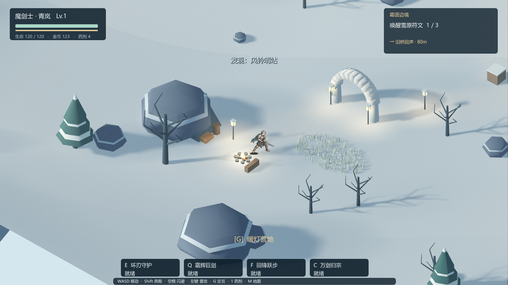
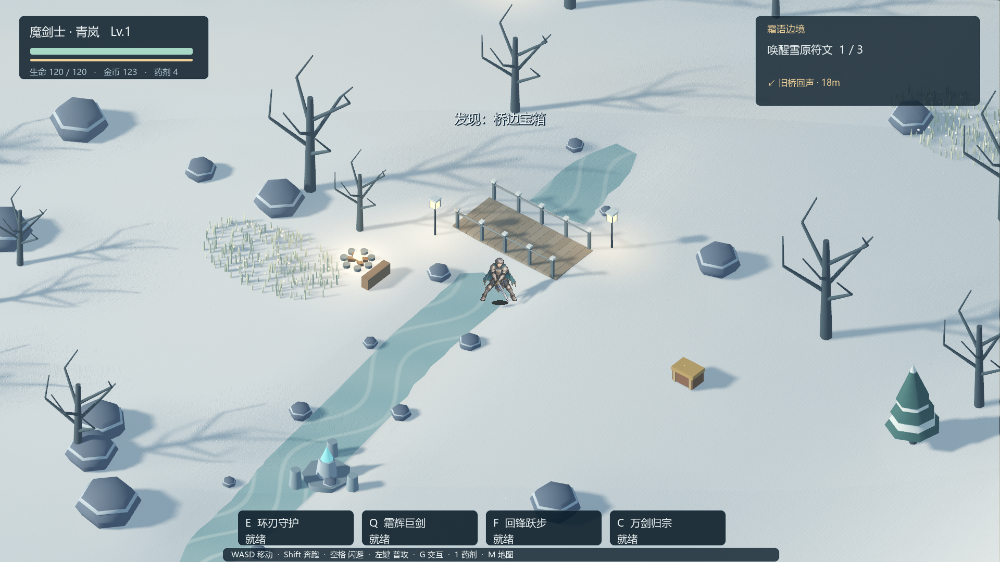
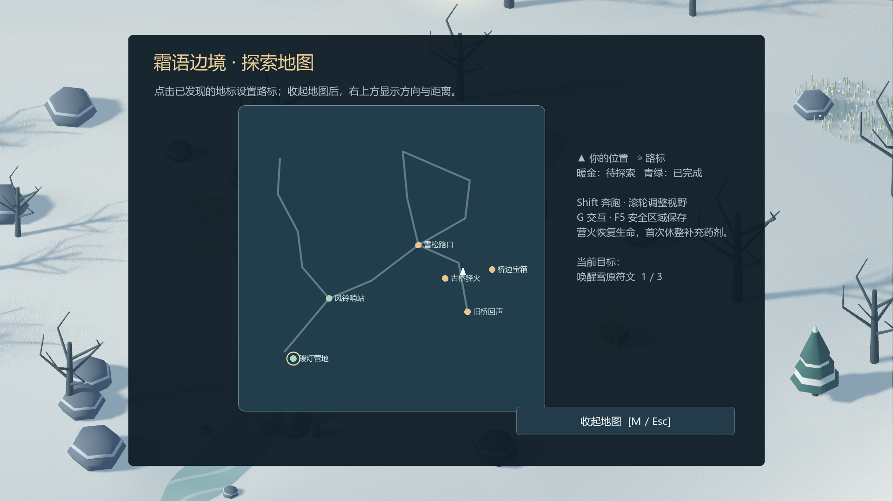
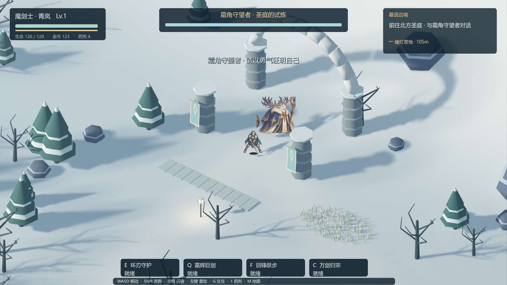
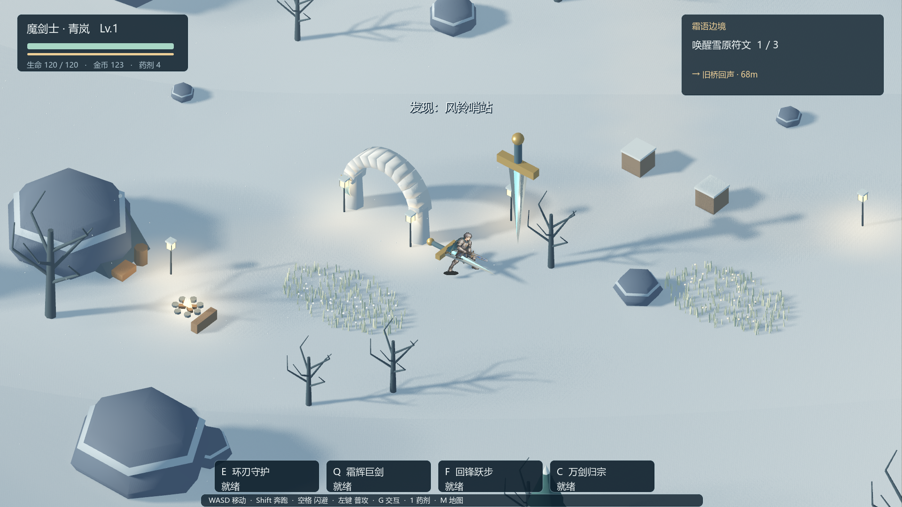

# 霜语边境 · 连续探索开发记录

日期：2026-10-15。分支：`codex/3d-frost-frontier`。版本：0.13.1。

## 当前可以玩的内容

从暖灯营地出发，选择魔剑士、火枪手或游侠，穿过连续雪原，挑战两处魔物营地并获得三选一祝福，探索支路宝箱，唤醒三处符文，最后挑战霜角守望者。地图约 130×130 米，采用真实 3D 地形、碰撞、正交跟随镜头、定向光阴影与局部暖光。

- 冰溪：可步行的浅冰溪，有低对比冰纹和流光；不是深水游泳系统。
- 古桥：独立桥面和护栏碰撞，地形衔接坡道，角色不需要跳跃即可穿过。
- 环境：远处山脊替代整齐的围墙式石圈；风动草叶、旗帜、飘雪、雪石、暖灯、营火组成冷暖层次。景观保持视野通透。
- 两处营火：暖灯营地和古桥驿火。无战斗及危险时恢复生命、体力和冷却；每处首次休整补一瓶药剂，药剂最多补到五瓶。重复休整不能重复领取药剂。
- 地图：只展示已发现地标。点击标记设置目的地；HUD 显示屏幕方向箭头和距离，地图收起后不遮挡战斗。
- 战斗：飞剑增加棱面剑尖、剑脊、护手和握柄；箭矢有箭头、箭杆及三片箭羽；火枪使用带金属环和亮点的球形魔法弹。材质和几何独立于伤害、碰撞与速度判定。
- 首领：独立血条短时滑入，半血后显示新的阶段称号，保留已有攻击节奏变化。

## 旅程保存

文件：`user://frontier_journey_v1.json`，仅用于 3D／2.5D 分支。原 2D 玩家存档不参与读取或写入。

安全条件下，进入新旅程、唤醒符文、领取祝福和营火休整会保存。F5 和暂停菜单支持手动保存。窗口关闭时如果安全会保存；战斗中退出保留上一次安全存档。首领战、未完成遭遇、未领取奖励、技能持续期间、危险预警和敌方弹体仍在场时不能保存。

保存角色、生命、等级／经验、金币、击杀、时间、药剂、四技能冷却、祝福、已领取／已清理／已发现地标、营火补给及导航点。继续时重建场景并恢复宝箱／符文表现，清除瞬时攻击对象。胜利或阵亡会结束此次旅程并清除续玩记录。

先写临时文件，再保留前一份 `.bak` 并替换主文件；字段与数值范围校验失败不载入，主文件损坏时尝试恢复上一份有效备份。没有把不可信存档实例化为 Godot 对象。

## 实际验证

- `tests/frontier_3d.gd`：82 项检查通过，覆盖三职业 12 项技能、释放时序、暂停／取消、弹体伤害、药剂、营地与奖励、符文、宝箱、Boss 结算。
- `tests/frontier_journey.gd`：41 项检查通过，覆盖营火补给防重复、完整状态续玩、清理营地不重生、战斗保存拒绝、磁盘写入与损坏恢复、角色实际过桥、鼠标地图点击、三职业实体武器、胜败终止存档。
- Godot 4.7.2，Vulkan Forward+，RTX 4060 Laptop：实际渲染运行同一旅程测试通过，并检查 1920×1080 的营地、桥梁、地图、三职业武器、Boss 与结算截图，无脚本或着色器运行错误。
- 测试使用隔离状态及临时测试文件，不写入真实玩家旅程。流程测试包含传送到检查点、直接击杀敌人等测试操作；不代表真人通关时长或最终难度平衡。未进行全程性能采样，不能把测试通过当作稳定 60 FPS 证明。

## 美术与范围

场景、古桥、山脊、武器和材质由代码建立真实 3D 网格。英雄沿用已有完整持械动作图，通过 SubViewport + Sprite3D 显示；敌人沿用已有西式奇幻图集。未宣称这些是新增手工建模或骨骼动画。新增程序网格没有引入第三方素材许可。

当前为一个连续探索章节。下一阶段建议先制作一套高质量角色模型与跑动／攻击绑定，再扩大地图分区、增加地标事件与敌人导航，最后逐项迁入装备构筑；不要用增加地图面积替代探索内容。

## 备份与版本隔离

本轮修改前，已将原有 3D 样板代码、场景、着色器和依赖美术打包到工作目录 `work/frontier-backup-20261015/frontier-before-upgrade.zip`。同级 `ThreefoldTrial-2D` 的脚本、场景和项目配置按 142 个文件核对内容哈希；此次不在该目录开发。仓库中其他历史未提交修改保留，不混入本轮提交。

## 实机截图

