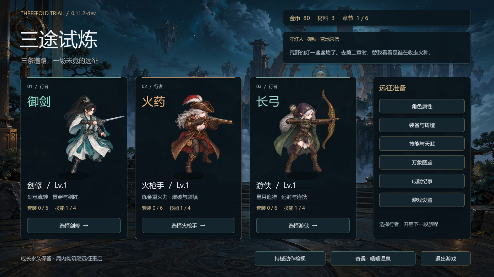
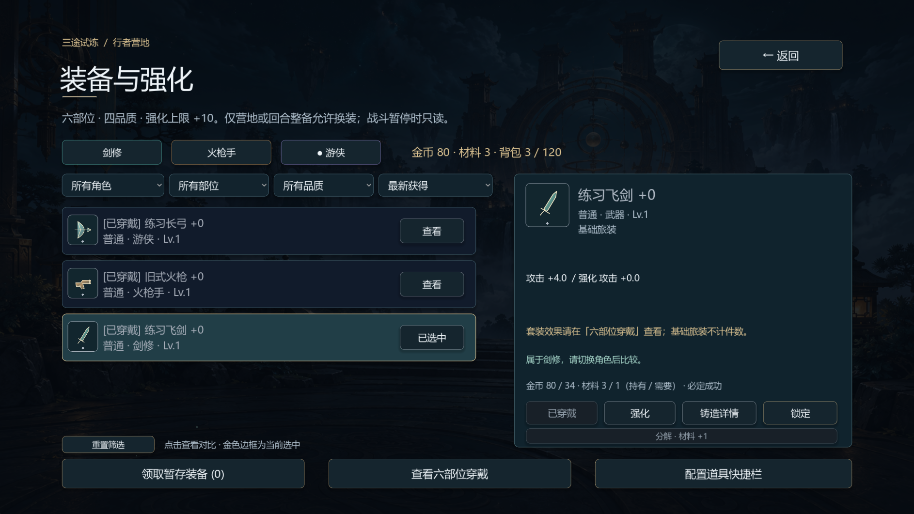
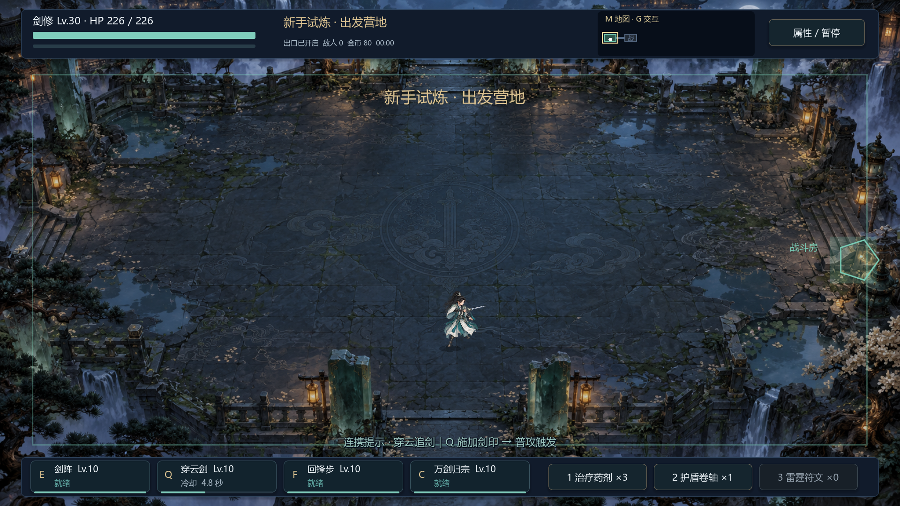
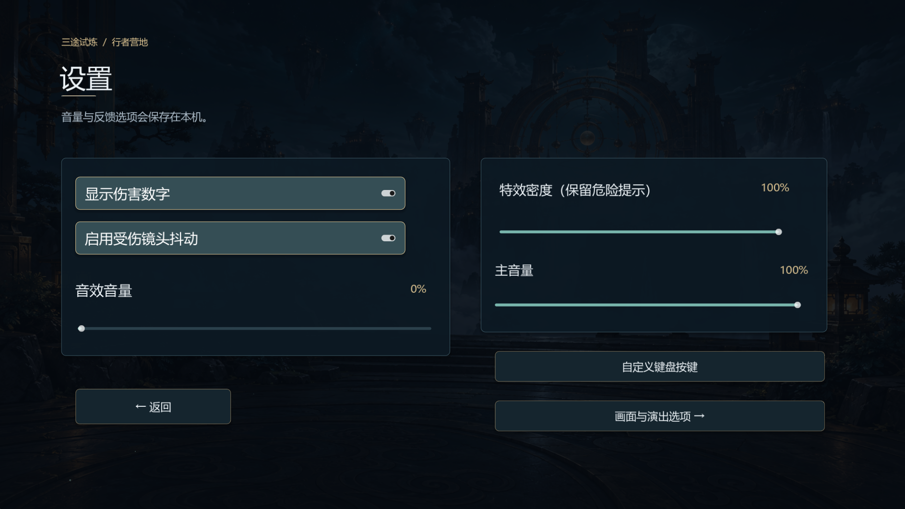

# UI 优化 · 2026-10-12

沿用回退后的整体美术、角色原画与场景。界面以青黑底、暖金边线和职业色作层次区分。

- 主菜单：三名角色使用统一尺寸的展示卡；职业名称、等级、套装和技能数量分层。资源与营地来信放在顶部，管理入口集中在右侧，奇遇、动作检视与退出放在底部。继续探索/深渊入口仍按存档显示。
- 通用控件：按按钮高度调整字号，长文截断并保留悬停提示，键盘焦点使用双像素边框；下拉菜单、搜索框、滚动条、提示框使用同一主题，次级文本提高亮度。
- 装备：当前选中装备使用金色边框和“已选中”文字；已穿戴装备显示“已穿戴”；保留实际强化条件与原有交易逻辑；增加重置筛选。
- 战斗：每个技能独立展示当前绑定按键、技能名、等级、就绪/冷却/解锁要求与细进度条；低于 25% 血量时血条转暖红；空药水和冷却药水禁用点击；连携提示在通知显示时避让。
- 设置：分组底板、统一滑条颜色，音效/主音量/特效密度展示实时百分比。原有保存、改键和窗口尺寸功能保留。

未更改战斗数值、掉落、玩家存档格式或角色动画。新增控件均放在现有 1920×1080 逻辑画布内。

## 验证

- `tests/ui_polish.gd`：50 项通过，覆盖角色选择回调、装备选中、筛选重置、天赋滚动位置、设置回调、1280×720 / 1920×1080 主菜单边界、技能冷却、血量警示、道具状态、通知避让和暂停隐藏。
- `tests/regression_v5.gd`：41 项通过，包含原有强化防连点、保存失败回滚、温泉和演出状态。角色按钮查询改为递归，以适应新的卡片层级。
- 实际 OpenGL 渲染运行：50 项通过，无脚本错误；人工检查菜单、装备、图鉴、设置、暂停、奖励和 HUD 截图。
- 测试使用隔离 APPDATA 与内存存档。沙箱内 headless 启动出现系统根证书读取提示，图形渲染运行未出现；不影响上述断言。
- 本轮未重跑完整六章、深渊或真人长期游玩；不把界面检查等同于完整游戏验收。

## 截图

运行验证：`Godot --headless --path . --script res://tests/ui_polish.gd`。渲染截图时移除 `--headless` 并追加 `-- --capture`。
