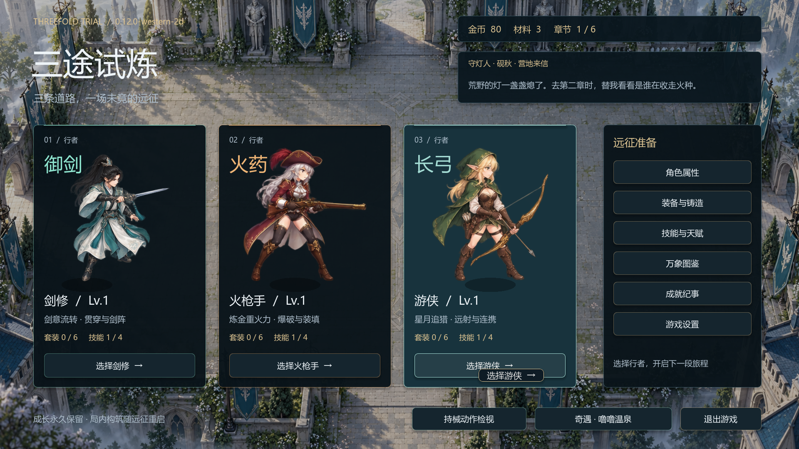
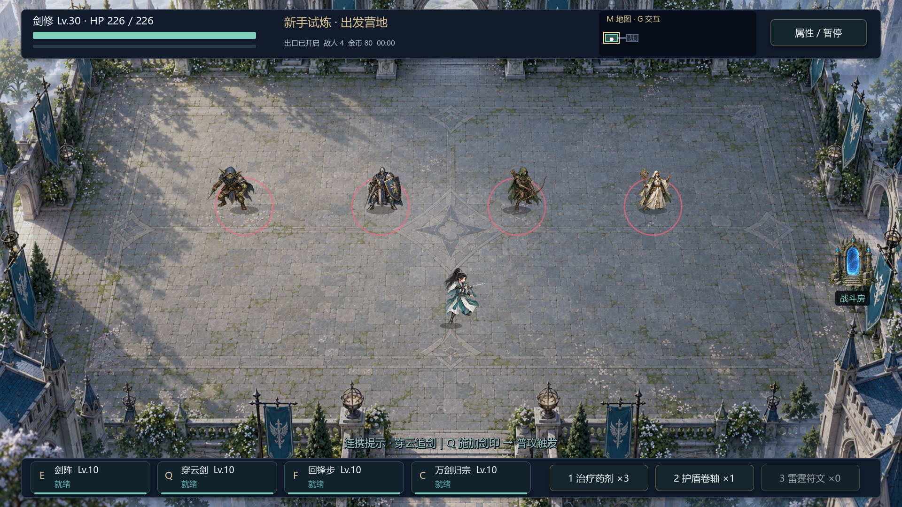
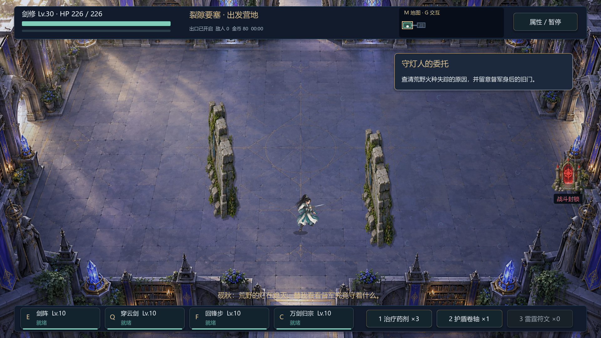

# 西方奇幻 2D 美术与音效试玩版

版本：0.12.0-western-2d；日期：2026-10-13。

后续玩家反馈：剑客已恢复 `f8f5ab1` 基线的完整持械画面与动画实现（`actor_integrated.gd`），覆盖菜单、战斗、行走、普攻、技能姿势和出手位置。其他角色以及本批地图、怪物、音效保持当前版本。技能数值和输入逻辑没有改动。下述三职业新美术中的剑客内容为回退前记录。回退后重新运行 142 项美术/音频专项，并更新实机截图。

背景音乐现采用用户提供的 [Moment of Peace](../audio/music/README.md)，全曲循环，在菜单、战斗、暂停和结算之间保持播放位置。设置提供独立音乐音量及自动保存；用户音乐的来源和授权记录与此前 CC0 音效分开保存。音乐专项 13 项、UI 50 项通过。

## 项目与回退

本版位于 `outputs/ThreefoldTrial-2D`，分支 `codex/2d-western-polish`，从纯 2D 基线 `f8f5ab1` 建立。打开这个文件夹的 `project.godot`，按 F5 运行。

原纯 2D 备份 `ThreefoldTrial-2D-Backup-2026-10-12`、ZIP 和 `backup/pure-2d-2026-10-12` 标签保持不变；原 `ThreefoldTrial` 中的 3D 雪原开发也没有覆盖或清理。本版保留游戏应用名称和存档结构，正常运行会继续使用既有 2D 存档。自动测试使用内存存档与隔离用户目录。

## 本批落地

- 六章背景采用西式庭院、秋林要塞、符文藏书殿、教堂、机关熔炉与星空观测台；噜噜场景采用奇幻庭园水池。沿用已有房间布局、碰撞、章节进度和分支路线。
- 宝箱开合、祭坛、恢复泉、锻炉、商人物品、封锁/开启传送门、符文石、木箱与横纵墙体使用同一套图集。静态 UV 网格按透明轮廓隔离，避免邻格的武器或物件露边。交互提示增加底板并移开角色中心。
- 三名主角采用西式铠甲剑士、黑火药枪手、披风游侠。人物和手持武器共同绘制；技能使用 AnimationPlayer 播放完整关键姿势，固定脚底基准，不以身体扭曲或缩放伪造动作。普通技能增加 0.12 秒准备动作，闪避、死亡和换房取消准备且不扣冷却；C 技能保留既有释放控制。
- 新怪物图集包含 16 个完整轮廓，覆盖哥布林、披甲野兽、守卫、骑士、构装体、术士、树灵等。19 个敌人 ID 中的变体复用对应轮廓，水豚噜噜仍使用原专属图。机制、数值、掉落不变；部分幼态名字改为提灯树灵、荆棘兽、爆裂野兽、幻影术士。
- 接入 22 段短音效：剑刃挥动、弓弦、黑火药枪单发与重击、装填、护甲/身体命中、法术、怪物、金币、界面与水声。声源均来自标注 CC0 的 OpenGameArt 素材页。
- 声音使用独立随机数、微小音高变体、95 毫秒共享命中间隔、650 毫秒怪物发声间隔，以及独立 UI / 重击声道。离开战斗会停止残留战斗音，正常界面切换保留点击反馈。已有胜负、成就短音及其余旧资源仍保留。

## 素材来源与实际性质

本批美术为项目已有及新增的 AI 辅助位图素材；不是手绘逐帧动画或 3D 建模。六章、英雄和道具接续此前未接入独立 2D 工程的素材。新怪物图由内置 ImageGen 生成，完整提示词保存在 [MONSTERS_PROMPT.txt](../art/western/MONSTERS_PROMPT.txt)，结果为 [monsters-v2.png](../art/western/monsters-v2.png)。Python 工具仅提取透明轮廓并生成 UV/脚底元数据，不修改这些原 PNG。

音频作者、直接素材页、许可、裁切与采样处理记录见 [音效来源](../audio/western/CREDITS.md) 和 [逐段清单](../audio/western/manifest.json)。`tools/prepare_western_audio.py` 可用下载的源包重新生成音频；处理包括单声道、滤波重采样、44.1 kHz PCM16、短淡入淡出与统一峰值，不声称这些录音是本项目原创。

## 试玩重点

1. 从角色卡进入战斗，检查三个职业的服装、武器位置与地图是否协调。
2. 普攻、技能和闪避交替，比较剑、枪、弓的声音辨识度；连续击中多个敌人时注意是否过响或过密。
3. 探索宝箱、商人、恢复泉、符文石、墙体与出口，检查交互物是否一眼可辨，以及实际碰撞是否符合预期。
4. 按 M 看路线，按 G 交互；技能及消耗品按键以 HUD 为准。声音强弱可在设置中调整。

## 验证与边界

本批 265 项断言通过：新美术/音频 142、输入与三职业技能取消 36、UI 50、原场景资源 37。实际 GPU 截图 11 张位于 [screenshots-western](screenshots-western)，测试房间的怪物为人工排布，只验证显示与运行；没有用截图冒充真人完整通关。

仍是房间式 2D 游戏，没有新增大世界、真实 3D 光影、完整骨骼动画或新的高帧跑步素材。连续跑动保持稳定完整姿势和轻微上下节奏；技能关键帧数量仍有限。没有重跑完整六章或无限深渊，也未完成多设备性能测试。音频已做解码、事件与限频检查，最终听感仍需玩家实际试玩反馈。

